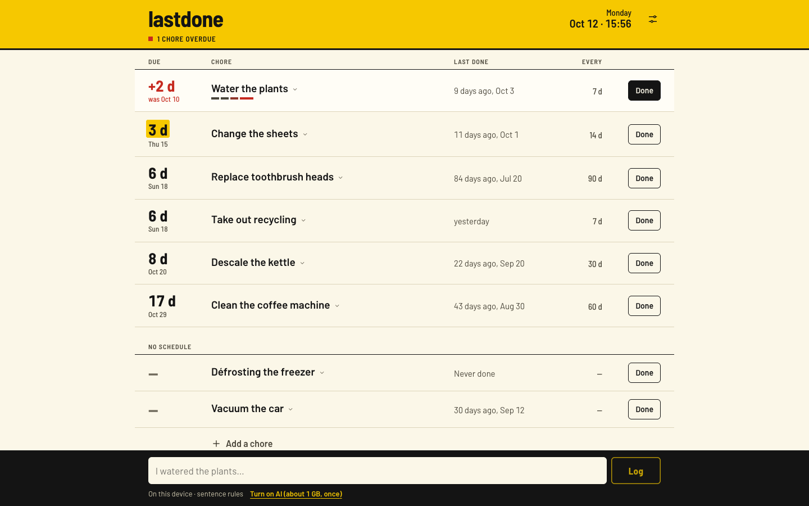
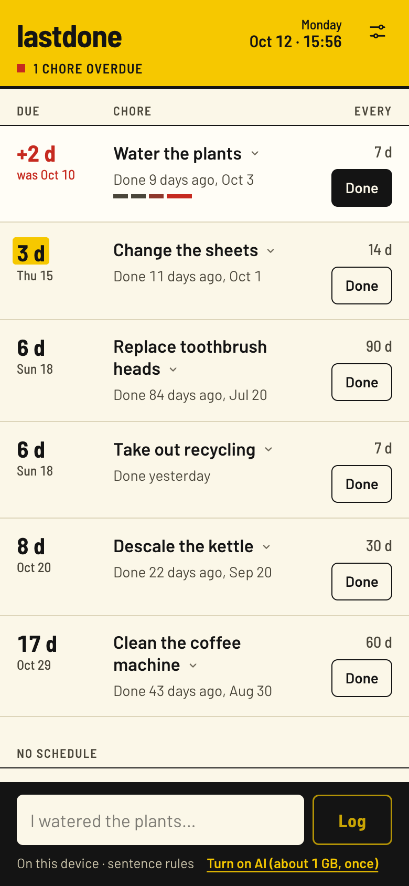
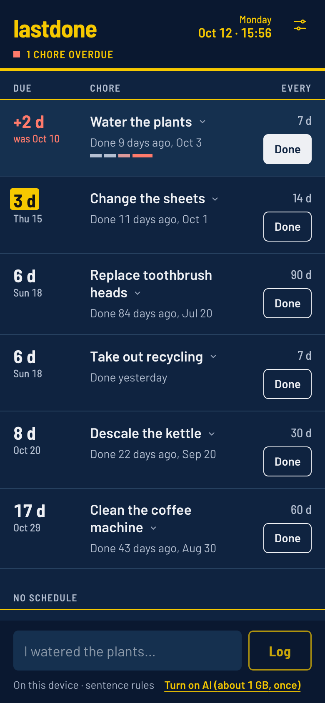

# lastdone

When did I last water the plants? lastdone keeps track of recurring chores and tells you when each one is due again. You talk to it in plain sentences, and a small language model running in your browser turns each sentence into an action. There is no backend, no account and no API key: your data stays on your device.

**App:** https://maxgfr.github.io/lastdone/



<p>
  
  
</p>

The chores in these screenshots are sample data.

## What you can say

| Sentence | What happens |
| --- | --- |
| `I watered the plants` / `j'ai arrosé les plantes` | Logs the chore today |
| `I descaled the kettle yesterday` / `… avant-hier`, `… lundi`, `… le 3 octobre` | Logs it on that day |
| `When did I last change the sheets?` / `c'est quand la dernière fois que j'ai …` | Last time, and how late or how soon the next one is |
| `Remind me to water the plants every 5 days` / `tous les 5 jours`, `every week` | Creates the chore, or changes its schedule |
| `Rename plants to balcony plants`, `delete the kettle` | Renames or deletes (deleting asks first) |
| `What's due?` / `qu'est-ce qui est en retard ?` | Lists overdue and upcoming chores |

Every chore also has a **Done** button, and tapping its name opens its history, a schedule editor and a way to log a past day. You never have to type.

If lastdone doesn't recognise a chore, it offers to create it rather than guessing.

## How it works

- The model ([Qwen2.5 1.5B Instruct](https://huggingface.co/mlc-ai/Qwen2.5-1.5B-Instruct-q4f16_1-MLC), about 1 GB, or 0.5B, about 400 MB, for smaller phones) runs with [WebLLM](https://github.com/mlc-ai/web-llm) in a Web Worker.
- Its output is constrained to a JSON schema: `{ action, task, date?, intervalDays?, newName? }`. The model only describes the intent. The app checks it and applies it with ordinary code, so the model never touches your data.
- The model downloads the first time you turn the AI on, either from the composer or from Settings. Your first sentence also starts the download, except on mobile data or with data saver on. After that it loads from the browser cache.
- Without WebGPU, or while the model is loading, a rule-based parser handles common French and English phrasing.

## Browser support

The AI needs WebGPU: recent Chrome or Edge on desktop and Android, and Safari 26 or later on macOS and iOS. Other browsers fall back to the sentence rules and the buttons, and everything else works the same.

## Reminders

- Overdue chores are flagged when you open the app, and the app icon gets a badge where the platform supports it.
- With notifications allowed in Settings, lastdone sends one notification a day for overdue chores while it is open or installed. Nothing reaches you when it is closed: there is no server to send push messages.
- **Export to calendar** writes an `.ics` file with one repeating event per scheduled chore, starting at its next due date. Logging a chore does not move those events, so export again (and replace the old calendar) after you log.

## Privacy

Chores and their history are stored in `localStorage` in your browser. Nothing is sent anywhere. The only network requests are the app itself and, if you turn the AI on, the model files from Hugging Face. Use **Settings → Export JSON** to back up or move your data, since clearing site data deletes it.

## Development

Requires Node 24 and pnpm.

```sh
pnpm install
pnpm dev        # http://localhost:5173/lastdone/
pnpm test       # Vitest
pnpm typecheck
pnpm build      # static site in dist/
```

Each push to `main` is built and deployed to GitHub Pages by `.github/workflows/deploy.yml`.

## License

MIT
